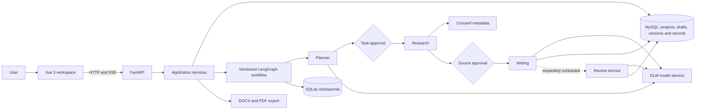

# PaperAgent

English | [简体中文](README.md)

**An AI-assisted workspace for planning, researching, drafting, and reviewing academic papers.**

PaperAgent brings project management, literature discovery, human review, writing, and quality review together in a local-first workspace. It helps you move from a research topic to a traceable draft while keeping chapter versions, citations, and workflow records accessible.

> **Use with care:** PaperAgent is a V1 prototype for a trusted local environment. It is not a fact-checking or academic-integrity certification system. Review the original sources, citations, generated claims, and AI feedback yourself before relying on or submitting a paper.

## What you can do

| Capability | How it works |
| --- | --- |
| Manage projects | Create, edit, archive, restore, and soft-delete paper projects. |
| Plan | The Planner generates structured tasks for you to approve in full, approve in part, or reject. |
| Discover literature | Research queries Crossref for academic metadata, ranks candidates using lightweight text matching, and flags duplicate DOIs and similar titles. You review the sources. |
| Write | Writing uses approved tasks and sources with available abstracts to build an outline and generate chapters in segments, with source and evidence links. |
| Review | Review examines evidence, structure, logic, and expression against specific chapter versions. It offers suggestions without changing your paper. |
| Revise | Request changes to a chapter, inspect previous versions, compare them, and restore an earlier version. |
| Read and export | Use the paper workspace to read chapters, inspect citations and review comments, and export Word, PDF, or a matching complete review report. |

Real Planner execution must be explicitly started. Mock workflows remain available for tests and compatibility with older runs. Model generation and review can incur provider charges.

## How it fits together



MySQL is the authoritative store for business data. SQLite stores workflow state and interruption checkpoints. The real Review service runs as a separately scheduled task after writing, rather than as a serial node in the versioned graph. SSE streams run events to the frontend; persisted events support replay, while transient text and heartbeats do not.

The current Research implementation uses Crossref metadata and available abstracts; it does **not** provide a vector database or full-text RAG. A real source is not necessarily relevant, and a matching excerpt does not prove that a claim is supported.

## Tech stack

- **Frontend:** Vue 3, TypeScript, Vite, Vue Router, Pinia, Axios, Element Plus.
- **Backend:** Python, FastAPI, Pydantic, SQLAlchemy, PyMySQL, Alembic.
- **Workflow:** LangGraph, SQLite Checkpointer, human-in-the-loop approvals.
- **Data and AI:** MySQL, Crossref REST API, GLM Chat Completion.
- **Documents and testing:** python-docx, ReportLab, pypdf, pytest, HTTPX, browser tests with Playwright/Chrome or Chrome DevTools Protocol.

## Repository layout

```text
PaperAgent/
├── 后端/                 FastAPI application, workflows, migrations and tests
│   ├── app/api/          HTTP endpoints
│   ├── app/services/     Business logic, agents, review and export
│   ├── app/models/       SQLAlchemy models
│   ├── app/repositories/ Project-scoped data access
│   ├── app/schemas/      Request and response contracts
│   ├── app/graph/        State, graph versions and checkpoints
│   ├── app/infrastructure/ Database, model and search adapters
│   ├── alembic/          Migration history
│   └── tests/            Backend tests
├── 前端/                 Vue application and frontend tests
├── docs/                 Seven current project documents (Chinese)
├── scripts/              Windows development launcher scripts
├── 启动 PaperAgent.bat    Start the local application
└── 停止 PaperAgent.bat    Stop processes created by the launcher
```

## Getting started on Windows

The documented local environment used Windows, Python **3.13.2**, Node.js **24.21.0**, npm **11.19.0**, and MySQL **8.0.44**. These are tested versions, not a guarantee that other versions are incompatible. You will also need Git, network access to Crossref, and GLM credentials with appropriate access and quota for real model calls. PDF output requires an appropriate Chinese font on the server.

### 1. Clone and install backend dependencies

```powershell
git clone https://github.com/Hairiisgoat/PaperAgent.git
cd PaperAgent\后端
py -3.13 -m venv .venv
.\.venv\Scripts\python.exe -m pip install -r requirements.txt
Copy-Item .env.example .env
```

Fill in `后端/.env` locally using the example. Configure a dedicated MySQL database account and, for real model calls, the GLM service. Never commit `.env` or put API keys in frontend configuration. If the Python launcher points to a missing installation, create the virtual environment with a working Python 3.13 executable instead.

### 2. Prepare MySQL and apply migrations

Create an independent `paper_agent` database and a dedicated account with the permissions appropriate to your environment. For an existing database, take a backup and verify the target, credentials, and migration chain first: MySQL DDL may implicitly commit. From the `后端` directory:

```powershell
.\.venv\Scripts\python.exe -m alembic current
.\.venv\Scripts\python.exe -m alembic heads
.\.venv\Scripts\python.exe -m alembic upgrade head
```

### 3. Install frontend dependencies and start

```powershell
cd ..\前端
npm ci
```

From the repository root, double-click `启动 PaperAgent.bat`; use `停止 PaperAgent.bat` to stop the processes started by the launcher. The launcher checks the database, ports, health endpoint, and development proxy. It does not install dependencies, run migrations, or start or stop MySQL.

Alternatively, start the services in separate PowerShell windows:

```powershell
# In 后端/
.\.venv\Scripts\python.exe -m uvicorn app.main:app --host 127.0.0.1 --port 8000
```

```powershell
# In 前端/
npm run dev -- --host 127.0.0.1
```

Open <http://127.0.0.1:5173/projects>. FastAPI's OpenAPI documentation is at <http://127.0.0.1:8000/docs>. The `/health` endpoint only indicates that the HTTP application responds; it does not verify MySQL or the model provider.

## Typical workflow

1. Create a course-paper project with a title, topic, and citation style.
2. Explicitly start the real Planner, then review its proposed tasks.
3. Inspect the literature Research finds and approve only sources relevant to the project.
4. Let Writing generate an outline and draft from the approved material, and monitor its progress.
5. Read the Review suggestions and independently check the evidence and claims.
6. Revise individual chapters as needed; inspect or restore earlier versions. Reports tied to older versions remain historical snapshots.
7. Export the draft as Word or PDF, and export a review report when a complete report matches the current chapter versions.

## Configuration

Use [后端/.env.example](后端/.env.example) and [前端/.env.example](前端/.env.example) as templates. Backend process environment variables take precedence over `.env` values.

| Variables | Purpose |
| --- | --- |
| `MYSQL_HOST`, `MYSQL_PORT`, `MYSQL_DATABASE` | MySQL connection target. |
| `MYSQL_USER`, `MYSQL_PASSWORD` | Dedicated database credentials. |
| `LANGGRAPH_SQLITE_PATH` | Local checkpoint file, relative to the backend working directory when not absolute. |
| `LLM_BASE_URL`, `LLM_MODEL`, `LLM_API_KEY` | GLM endpoint, model and API key. Features that do not call a model can start without a key. |
| `LLM_TIMEOUT_SECONDS`, `LLM_PLANNER_READ_TIMEOUT_SECONDS` | General request timeout and Planner read timeout. |
| `VITE_API_PROXY_TARGET` | Vite development proxy target; never use it for secrets. |

The default development proxy sends `/api` to `http://127.0.0.1:8000`. Production API routing, HTTPS, and authentication are not supplied as a complete deployment solution.

## Tests

```powershell
# In 后端/: the default suite skips explicitly enabled live-service tests
.\.venv\Scripts\python.exe -m pytest -q

# In 前端/: strict type checking and production build
npm run build
npm ls --depth=0
```

Default tests primarily use mocks and do not prove a real GLM call or full manual acceptance. MySQL integration tests require explicit opt-in and prior inspection of their isolation: some use rollback in a dedicated database, while others require a temporary MySQL instance. Do not enable `RUN_MYSQL_INTEGRATION` without checking the environment.

The live GLM smoke test is opt-in via `PAPERAGENT_LLM_LIVE_TEST=1` and may incur charges. Do not automatically retry model calls whose results are unknown. See the [frontend README](前端/README.md) and [test and acceptance report](docs/06_测试与验收报告.md) for browser-test details and constraints.

## Documentation

The following current project documents are in Chinese:

1. [Requirements and functionality](docs/01_项目需求与功能说明书.md)
2. [System architecture](docs/02_系统架构设计说明书.md)
3. [Database design](docs/03_数据库设计说明书.md)
4. [API reference](docs/04_API接口说明书.md)
5. [Deployment and operations](docs/05_部署与运行手册.md)
6. [Testing and acceptance](docs/06_测试与验收报告.md)
7. [Project development summary](docs/07_项目开发总结.md)

## Known limitations

- Literature abstracts may not support detailed claims. Relevance, citations, evidence, and model review comments require human verification; an excerpt match is not proof of semantic support or factual accuracy.
- The application does not yet provide complete user registration, authentication, or multi-user authorization. Project scoping is not a substitute for access control; do not expose the service directly to the public internet.
- MySQL, SQLite, and external providers do not share an atomic transaction or guarantee exactly-once model billing. An uncertain result requires manual reconciliation and may have incurred charges.
- A chapter revision makes reports tied to its older version historical. A current review export requires a complete report matching the current versions.
- Word output has been parsed and checked with other office software, but has not been validated in Microsoft Word itself. Chinese PDF rendering depends on available fonts.
- Reliable subsection navigation is not yet available; the project run list shows at most the most recent 50 entries. Current scheduling and event broadcasting target a local single-process deployment.

## What's next

Potential improvements include mobile reading, version comparisons, subsection navigation, source quality, and review interactions. Longer-term directions include authentication, multi-process recovery and event delivery, reconciliation tools, broader evidence sources, and repeatable quality evaluation. These are plans, not implemented features.

## License

This repository does not currently include an explicit open-source license. Contact the project owner before using or distributing the code.
