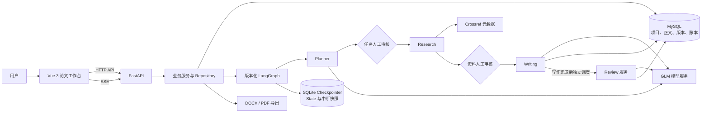

# PaperAgent

**面向本地研究流程的 AI 论文规划、写作与审查助手。**

PaperAgent 将论文项目管理、任务规划、学术资料检索、人工审核、分段写作与质量审查组织在同一工作台。它帮助使用者从研究主题出发形成可追溯的论文初稿，并保留修改版本、引用依据和工作流运行记录。

> **定位与边界：**这是面向可信本机环境的 V1 原型，不是自动事实核验或学术诚信认证系统。模型生成的论述、文献相关性和审查意见都需要人工核验；不得把摘要中未出现的实验数据或结论当作已证实事实。

## 功能概览

| 能力 | 当前实现 |
| --- | --- |
| 项目管理 | 创建、查询、编辑、归档、恢复与软删除；按项目隔离工作流资源 |
| Planner Agent | GLM 生成结构化任务，服务端校验并保存；支持用户部分批准、全部批准或拒绝 |
| Research Agent | 从 Crossref 检索真实学术元数据，进行词面排序、DOI 去重和相似标题提示；资料须经人工审核 |
| Writing Agent | 基于已批准任务和有可用摘要的来源生成大纲与分段正文；正文、引用和证据保存在 MySQL |
| Review Agent | 按章节版本审查证据、逻辑和表达，生成可定位的意见；不直接修改论文 |
| 章节版本 | 对单章提出修改要求、查看历史版本、对比并恢复；旧版本保留 |
| 阅读与导出 | 三栏论文工作台、引用详情、审查意见定位，以及 Word、PDF、当前完整审查报告导出 |
| 运行追踪 | LangGraph 人工中断与恢复、运行/事件记录、SSE 状态推送及断线续传 |

当前真实 Planner 显式启用；Mock 工作流仍用于测试与历史兼容。论文生成和审查会调用外部模型服务，可能产生费用。

## 系统架构



Vue 通过 FastAPI 接口读取项目、工作流、论文及审查报告，并通过 SSE 订阅运行事件。LangGraph 的版本化流程组织 Planner → 任务审核 → Research → 资料审核 → Writing；真实 Review 在写作完成后作为**独立审查任务**执行，并非图工厂内的串行节点。

- **MySQL** 是项目、任务、资料、正文、版本、审查和调用账本的业务权威来源。
- **SQLite Checkpointer** 保存轻量工作流状态和中断快照；`thread_id` 标识可恢复的流程，`run_id` 标识每次独立执行尝试。
- **GLM 与 Crossref** 分别提供模型生成和文献元数据。两者、MySQL 与 SQLite 之间没有跨系统原子事务；结果不确定时应人工核对，不能盲目重试。
- SSE 持久化事件支持按序恢复；临时文本与心跳不承诺重放。当前内存广播与恢复调度仅面向本地单进程。

## 技术栈

| 层次 | 主要技术 |
| --- | --- |
| 前端 | Vue 3.5、TypeScript 5.9、Vite 7、Vue Router、Pinia、Axios、Element Plus |
| 后端 | Python 3.13、FastAPI、Pydantic、Uvicorn、SQLAlchemy、PyMySQL、Alembic |
| Agent 与状态 | LangGraph、SQLite Checkpointer、Human-in-the-loop |
| 数据与检索 | MySQL、Crossref REST API；按任务和主题进行轻量词面排序与去重 |
| 模型 | 智谱 GLM Chat Completion；通过服务端配置访问 |
| 导出与测试 | python-docx、ReportLab、pypdf、pytest、HTTPX；浏览器测试使用 Playwright/Chrome 或 Chrome DevTools Protocol |

**检索边界：**当前使用 Crossref 元数据与可用摘要作为证据上下文，并未实现向量数据库或完整全文 RAG。数据源真实不等于资料相关，更不等于资料充分支持某个论断。

## 项目结构

```text
PaperAgent/
├── 后端/
│   ├── app/
│   │   ├── api/              # FastAPI 路由
│   │   ├── core/             # 配置与基础能力
│   │   ├── models/           # SQLAlchemy ORM
│   │   ├── schemas/          # Pydantic 契约
│   │   ├── repositories/     # 项目范围数据访问
│   │   ├── services/         # Agent、业务编排、审查与导出
│   │   ├── agents/           # Mock Agent
│   │   ├── graph/            # State、图版本、Checkpointer
│   │   └── infrastructure/   # 数据库、模型及检索适配
│   ├── alembic/              # 迁移历史
│   ├── tests/                # 单元及集成测试
│   ├── .env.example
│   └── requirements.txt
├── 前端/
│   ├── src/components/       # 工作台、审核等组件
│   ├── src/views/            # 项目及运行页面
│   ├── src/services/         # API 与 SSE 客户端
│   ├── src/stores/           # Pinia 状态
│   ├── tests/                # 浏览器测试
│   └── package-lock.json
├── docs/                     # 七份正式文档
├── scripts/                  # Windows 启动、停止工具
├── 启动 PaperAgent.bat
└── 停止 PaperAgent.bat
```

## 环境准备

本机验收使用 Windows、Python **3.13.2**、Node.js **24.21.0**、npm **11.19.0**、MySQL **8.0.44**。这些是已验证环境，并非声明其他版本必然不兼容。安装依赖时以前端 `package-lock.json` 和后端 `requirements.txt` 为准。

还需要 Git、可访问的 Crossref 网络，以及具有有效额度和权限的 GLM API 配置。PDF 生成依赖服务器上的中文字体；Windows 一键启动脚本依赖 PowerShell。

## 快速开始（Windows PowerShell）

### 1. 获取代码

```powershell
git clone "https://github.com/<你的GitHub账号>/PaperAgent.git"
cd PaperAgent
```

私有仓库需要当前账号拥有访问权限。以下命令以仓库根目录为起点。

### 2. 安装后端依赖

```powershell
cd .\后端
py -3.13 -m venv .venv
.\.venv\Scripts\python.exe -m pip install -r requirements.txt
Copy-Item .env.example .env
```

如果 `py -3.13` 指向失效的旧解释器，请改用本机有效的 Python 3.13 可执行文件创建虚拟环境，例如 `& "<Python 3.13 安装目录>\python.exe" -m venv .venv`；把尖括号内容替换为实际路径。本项目此前的 Windows 环境中曾发现 Python Launcher 注册路径失效。

编辑本机 `后端/.env`，填写独立数据库账号和密码，以及按需配置 GLM。不要提交该文件或在前端放置密钥。

### 3. 准备数据库与迁移

在 MySQL 管理客户端中由有权限的管理员创建独立数据库和专用账号。下方密码只是占位提示，**请由管理员替换**；不要复用其他项目账号或数据库。账号权限与迁移权限应按实际环境管理。

```sql
CREATE DATABASE paper_agent CHARACTER SET utf8mb4 COLLATE utf8mb4_unicode_ci;
CREATE USER 'paper_agent_app'@'127.0.0.1' IDENTIFIED BY '<自行设置的密码>';
GRANT ALL PRIVILEGES ON paper_agent.* TO 'paper_agent_app'@'127.0.0.1';
```

已有数据库时，先备份并确认目标、账号、迁移链和权限，避免影响其他项目。MySQL DDL 可能隐式提交。确认后在 `后端` 目录执行：

```powershell
.\.venv\Scripts\python.exe -m alembic current
.\.venv\Scripts\python.exe -m alembic heads
.\.venv\Scripts\python.exe -m alembic upgrade head
```

### 4. 安装前端依赖

```powershell
cd ..\前端
npm ci
```

### 5. 启动应用

从项目根目录双击 `启动 PaperAgent.bat`，使用结束后双击 `停止 PaperAgent.bat`。启动器检查数据库、端口、健康接口和开发代理，只监听本机，不会自动安装依赖、运行迁移或启停 MySQL。

也可在两个 PowerShell 窗口中分别运行：

```powershell
# 后端目录
.\.venv\Scripts\python.exe -m uvicorn app.main:app --host 127.0.0.1 --port 8000
```

```powershell
# 前端目录
npm run dev -- --host 127.0.0.1
```

打开 `http://127.0.0.1:5173/projects`；后端 OpenAPI 文档位于 `http://127.0.0.1:8000/docs`。`/health` 只表示 HTTP 应用可响应，不代表 MySQL 或模型服务可用。

## 使用流程

1. 创建课程论文项目，填写名称、主题和引用格式。
2. 显式启动真实 Planner，审核生成任务，可部分批准或拒绝。
3. Research 检索候选文献；检查标题、来源和摘要，选择真正相关的资料并审核。
4. Writing 使用已批准的任务和可用摘要自动生成大纲及章节；查看运行状态和失败提示。
5. Review 对章节版本给出结构化意见，检查证据是否支持论点；用户自行判断。
6. 按需修改指定章节、查看和恢复历史版本。正文变化后，旧审查报告会标记为历史快照。
7. 从论文工作台下载 Word、PDF；审查报告导出要求存在匹配当前章节版本的完整报告。

## 配置说明

配置模板：[后端/.env.example](后端/.env.example)、[前端/.env.example](前端/.env.example)。后端同名进程环境变量优先于 `.env`；不要输出完整配置或密钥。

| 变量 | 作用 |
| --- | --- |
| `MYSQL_HOST`、`MYSQL_PORT`、`MYSQL_DATABASE` | MySQL 地址、端口和独立数据库 |
| `MYSQL_USER`、`MYSQL_PASSWORD` | 专用数据库账号和密码 |
| `LANGGRAPH_SQLITE_PATH` | 本地 Checkpointer 文件路径；相对路径以启动后端时的工作目录为准 |
| `LLM_BASE_URL`、`LLM_MODEL`、`LLM_API_KEY` | GLM 接口地址、模型和密钥；未配置密钥仍可启动不依赖模型的功能 |
| `LLM_TIMEOUT_SECONDS`、`LLM_PLANNER_READ_TIMEOUT_SECONDS` | 通用超时和 Planner 读取超时 |
| `VITE_API_PROXY_TARGET` | 前端开发代理目标，不用于存放任何秘密 |

Vite 开发代理默认将 `/api` 转发至 `http://127.0.0.1:8000`。生产环境需自行处理 API 转发、History 路由回退、认证与 HTTPS；本项目当前不提供完整公网部署方案。

## 测试

```powershell
# 后端目录：默认跳过显式启用的真实服务测试
.\.venv\Scripts\python.exe -m pytest -q

# 前端目录：TypeScript 检查和 Vite 生产构建
npm run build
npm ls --depth=0
```

默认测试主要使用 Mock，不代表真实 GLM 或完整人工验收。真实 MySQL 集成测试必须显式启用并先审查每个测试的隔离方式：部分测试针对专用数据库事务回滚，部分要求独立临时 MySQL 实例。不要在未检查的环境中启用 `RUN_MYSQL_INTEGRATION` 或一次性数据库测试。

真实 GLM 冒烟测试仅在显式设置 `PAPERAGENT_LLM_LIVE_TEST=1` 后执行，会产生真实请求及可能费用；不得把它加入默认回归或对结果未知的请求自动重试。浏览器测试使用已有 Playwright 和 Chrome，测试入口、环境变量及写入限制详见 [前端 README](前端/README.md) 和[测试与验收报告](docs/06_测试与验收报告.md)。

## 项目文档

1. [项目需求与功能说明书](docs/01_项目需求与功能说明书.md)
2. [系统架构设计说明书](docs/02_系统架构设计说明书.md)
3. [数据库设计说明书](docs/03_数据库设计说明书.md)
4. [API 接口说明书](docs/04_API接口说明书.md)
5. [部署与运行手册](docs/05_部署与运行手册.md)
6. [测试与验收报告](docs/06_测试与验收报告.md)
7. [项目开发总结](docs/07_项目开发总结.md)

## 已知限制

- 文献摘要有限，可能出现主题偏离、引用集中、证据不足及模型审查误判；原文摘录匹配不等于语义支持或事实已核实。
- 当前没有完整的用户注册、认证或多用户授权，项目范围校验不能代替访问控制；不适合直接暴露公网。
- MySQL、SQLite 和供应商之间不具备原子事务或 exactly-once 保证；模型调用结果未知时需人工对账，可能产生费用。
- 当前章节修改会使依赖旧版本的审查报告成为历史快照；当前完整报告不存在时不能导出为当前审查结果。
- Word 文件已按文档记录进行格式解析和其他办公软件检查，尚未完成 Microsoft Word 实机兼容性验收；PDF 中文依赖运行环境字体。
- 工作台暂无可靠小节导航；项目运行列表最多显示最近 50 条；当前版本仅面向本地单进程。

## 后续方向

V1 可继续优化移动端阅读、版本对比、小节导航、资料质量和审查交互。未来可探索用户认证、可靠的多进程调度与事件广播、人工对账界面、更丰富的证据来源和可重复质量评测；这些是规划，不代表当前已经实现。

## 许可证

仓库目前未包含明确的项目开源许可证；使用或分发前请联系项目负责人确认授权。
