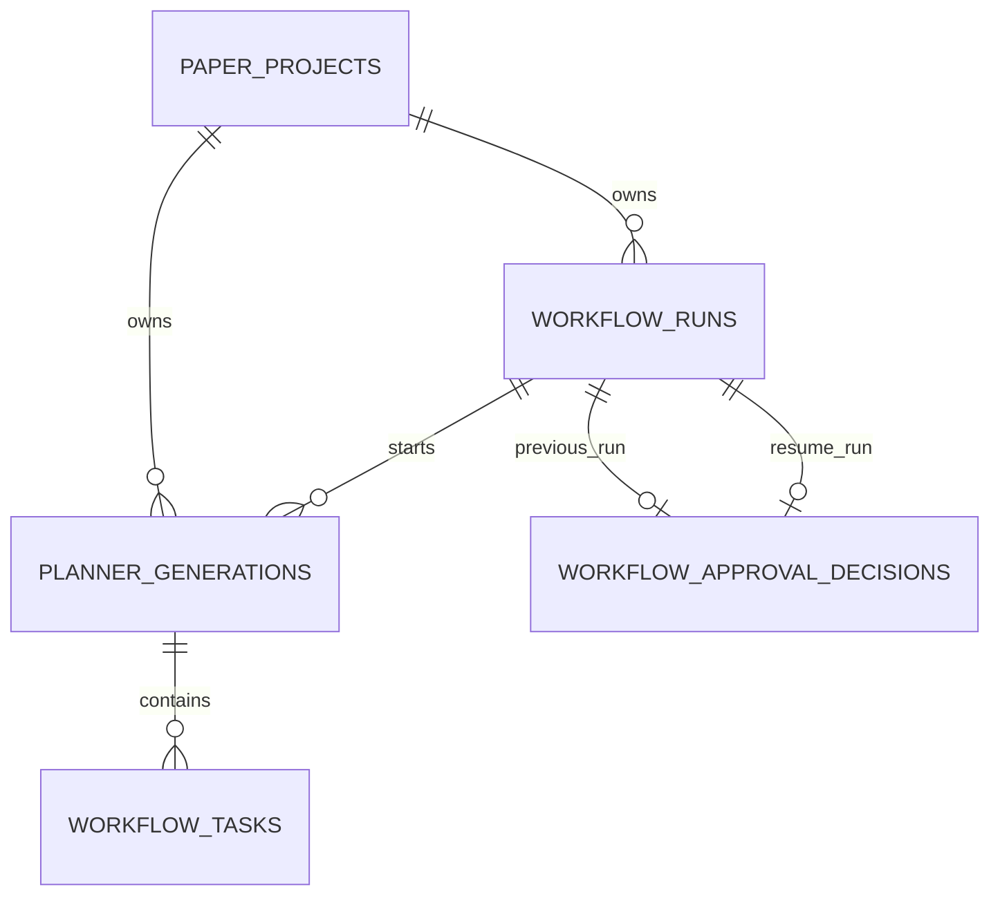

# M2-08-02：真实 Planner 业务契约设计（待评审）

> **评审状态：**负责人已确认新增 `workflow_tasks` 和 `planner_generations`、复用现有审核、首版仅支持课程论文且不支持非空 requirements；并确认持久化 `graph_version`、在 State 增加 `planner_generation_id`、保存不可变输入快照，以及真实 Planner 审核后暂停。3–8 条任务和 2048 输出 token 是首版采用的初始值。具体实现、迁移和 API 仍未完成；本阶段仅修改本文。

## 1. 现有架构与事实

| 部分 | 当前代码行为 | 对真实 Planner 的含义 |
| --- | --- | --- |
| `app/graph/state.py` | `tasks` 和 `approved_task_ids` 均为 UUID 字符串列表；`budget_accounting` 包含已知总量、完整性和调用 ID。TypedDict 不做运行时校验。 | State 保存轻量引用，不保存任务正文或完整模型响应；节点必须自行校验并显式合并用量。 |
| `app/agents/mock_planner.py` / `mock_research.py` | Planner 根据项目生成确定性 Mock ID；Research 验证批准 ID 是任务集合的非空子集。 | 现无真实任务内容，也没有真实任务的数据库读取。Mock 必须保留。 |
| `app/graph/approval_graph.py` | Planner → 任务 interrupt → Research → 资料 interrupt → Writing → Review；拒绝后不进入下一节点。 | 真实任务要在 interrupt 前已可靠落库；恢复审核节点时不能重做模型调用或创建新任务。 |
| `WorkflowRun` | 每次运行/恢复一个 `run_id`；同一 `thread_id` 的 `attempt_no` 递增。 | 任务按工作流线程和生成批次归属，并记录原始 Planner run；后续审核新 run 不改变任务归属。 |
| `WorkflowApprovalDecision` / `workflow_resume.py` | 审核决定、已批准 ID、新 run 和 queued 事件在同一事务；同一旧 run 的相同提交返回原结果，不同决定冲突。 | 应复用原有决定作为批准依据，不另造一套审核记录；实际原子边界仍限于 MySQL。 |
| `WorkflowApprovalService` | 校验项目、当前最新 run、waiting_human、事件及 SQLite interrupt / checkpoint；返回 `item_ids`。 | 扩展展示时必须在既有检查后读取同一批次的任务，不接受客户端传入任意 thread。 |
| `WorkflowEvent` | `approval_required.payload_ref` 目前是该 run 的 UUID，不是任务详情或 URL。 | 可作为调用现有审核详情接口的锚点，不能单独展示标题；可兼容扩充详情 API，无需先改 SSE。 |
| `LLMService` / `UsageAccumulator` | 同步调用，`invoke` 默认 256 输出 token；返回文本、可空用量和 `call_id`；不自动重试。用量累计器非线程安全，旧 checkpoint 缺字段时按不完整处理。 | Planner 必须显式提供任务级预算、校验输出和持久化调用信息；不能宣称当前已实现结构化输出或跨系统精确一次。 |
| `workflow_recovery.py` | 单进程扫描符合条件的 queued；running 只诊断、不盲目重放。 | 真实模型调用后的恢复需增加可审计的调用意图和对账方案，不能沿用 Mock 的纯函数假设。 |
| `app/api/workflow_events.py`、`mock_start.py`、`workflow_resume.py` | 现有 POST `/runs` 固定启动 `run_mock_attempt`；启动和恢复均调用 `build_approval_graph()`，后者把四个节点绑定为 Mock。 | 真实 Planner 不能只替换一个函数；入口、审核详情、恢复扫描及恢复 worker 必须一致选择持久化的图模式与版本。 |

**代码核对发现的实施阻塞：**（1）`GLMClient._invoke` 在校验后、发送之前自行生成 `call_id`，现有调用方无法预先持久化同一 ID；部分校验错误的 `LLMError.call_id` 还是 `None`。（2）启动恢复的 `submit_initial` 固定调度 Mock，审核详情和恢复也固定构建 Mock 图；没有持久化图模式及版本。直接接入真实节点会在重启或恢复时误用 Mock。（3）`WorkflowApprovalService._extract` 严格验证 checkpoint metadata 的 run/project、节点名称、interrupt 键与有序 ID；任何新图和响应扩展必须保持兼容或同步评审，不可假设自动兼容。（4）现有 `UsageAccumulator` 只是本地快照工具，并非持久化调用账本。以下解决方案均有待实施和验证。

当前不存在本设计所需的真实任务表、真实任务详情和真实 Research 消费逻辑；没有用户认证，也不能将项目范围校验称为用户授权。

## 2. Planner 输入契约

Planner 从经过 `ProjectScope` 验证的 active 项目读取以下字段；deleted / 不存在按现有规则 404，archived 不允许启动或写入，遵循现有冲突语义。输入版本以执行前形成的不可变快照为准，不能在崩溃后悄悄改用被用户更新过的项目内容。

| 字段 | 模型上下文 | 约束与处理 |
| --- | --- | --- |
| `title` | 是 | 使用已有项目值，非空、最多 200 字符。 |
| `topic` | 是 | 已有项目 API 允许很长文本；建议 Planner 接受上限 4,000 Unicode 字符，同时限制 UTF-8 编码不超过 16 KiB。超过则安全报错并要求用户调整，不静默截断。 |
| `paper_type` | 是 | **已确认**首版真实 Planner 仅接受 `course_paper`；其他类型明确拒绝并提示尚不支持，不修改项目 CRUD 契约。 |
| `citation_style` | 是 | 使用项目中的非空自由文本，最多 40 字符；它不是固定枚举。 |
| `requirements` | 暂不进入模型 | 当前仅保证可空 JSON 对象，没有经过评审的字段及语义；不可把任意 JSON 展开为系统指令或假定字数、格式。 |

`requirements` 即使结构合法，也可能含敏感信息、超深嵌套或提示注入。**已确认：首版只接受 `null` 或空对象 `{}`，非空对象明确拒绝并告知用户，不调用模型，不能静默忽略。**以后仅将经负责人批准、类型和长度受限的字段映射到模型输入，未知字段不透传；同时设置大小、深度和数量上限。

Prompt 建议采用固定系统指令加独立的数据消息，声明项目文本是不可信输入，要求输出下面的 JSON；只将上述必要字段传给模型，不传 `.env`、密钥、数据库连接、`user_id`、运行标识、其他项目、完整附件、历史异常或原始模型响应。输入中用户自己填写的项目文字仍可能含敏感信息，不能保证模型供应商不会接收它，真实接入前需明确数据外发范围。不得把这些数据或完整 Prompt 写入日志、SSE、State 或错误信息。

**已确认：真实 Planner 启动时保存不可变项目输入快照。**拟议在项目范围及生命周期校验后，读取并校验项目的 `title`、`topic`、`paper_type`、`citation_style` 和 `requirements`，在启动事务中将所需字段快照与 generation 意图、queued run 和事件一起提交，提交成功后才调度；`requirements` 仅允许 `null` 或 `{}`。模型执行和崩溃恢复均读取该快照，即使项目后来修改也不替换其内容。快照不是完整 Prompt，属于需按项目范围保护的业务数据；保存位置、访问控制和保留期限在实施设计中明确。

## 3. Planner 输出契约

首版建议将任务定义为互相独立、可直接交给 Research 的资料检索与分析工作项。模型只输出 JSON 文本，不输出业务 UUID，服务端严格解析后逐项生成 UUID4。示意格式（示例仅描述结构）：

```json
{
  "tasks": [
    {
      "title": "任务名称",
      "description": "说明需要研究的问题和范围",
      "expected_output": "资料与研究要点"
    }
  ]
}
```

| 字段 | 建议约束 | 选择理由 |
| --- | --- | --- |
| `tasks` | 必填数组，3–8 项；禁止额外顶层字段 | 已确认采用该首版初始范围；后续可根据验收数据评估。 |
| `title` | 必填、去首尾空白后 1–80 字符 | 审核列表可读。 |
| `description` | 必填、去首尾空白后 1–300 字符 | 提供足够的研究范围，不生成正文。 |
| `expected_output` | 必填、去首尾空白后 1–120 字符 | 说明交付物，如研究要点或资料清单，不代表真实资料已经存在。 |
| `task_id` | 不接受模型输出；服务端校验成功后生成 UUID | 业务身份不依赖模型的字符串或编号。 |

拟议业务解析流程：仅对供应商协议层接受的完整 `LLMResult.text`，先检查 UTF-8 字节数（建议 32 KiB），严格按单个 JSON 值解析、拒绝重复键、NaN/Infinity、尾随非空数据和 Markdown 包装；再使用严格 Pydantic Schema，禁止额外字段及类型强制转换。对标题和描述分别做 Unicode NFKC、空白折叠和大小写折叠：**仅当两个任务规范化后的标题和描述均完全相同**时，作为确定性重复拒绝整批；仅描述相似、仅描述相同或仅标题相同均不据此拒绝。该规则不声称检测所有语义重复。字符数按 Python Unicode code point 计、对清理后的存储文本检查；NFKC/空白/大小写折叠仅用于比较，不静默改写用户展示文本。所有任务和整体约束通过后服务端才生成 UUID 并在单事务写入，不保留半批或未校验原文。

不在首版模型 Schema 中加入 `dependencies`、`priority`、`objective` 和 `acceptance_criteria`：独立任务允许现有审核任意部分批准，`description` 和 `expected_output` 已覆盖最小目的与交付物。`dependencies` 及其他未声明字段一律作为非法额外字段拒绝，因而非法依赖不会被存储或执行；并非已实现依赖图校验。将来若增加依赖，须先设计有向无环图、同批引用及部分批准时的依赖闭包，经过 API 和交互评审后再引入，不能静默改变现有审核规则。

固定处理规则：

- 无法解析 JSON、空数组、字段缺失/额外、超限、重复或不符合结构：整个结果视为 `invalid_output`，不发布待审核事件、不创建部分任务；记录固定安全错误和调用用量，不记录文本。
- `LLMError.output_truncated`：标记输出截断，保留已知用量，不使用部分 JSON；不自动追加请求或提高预算。
- 空回答、非法供应商响应、工具调用：沿用 LLM 层安全错误；不得把 reasoning 或 tool call 当作结果。
- JSON 校验错误对客户端只返回安全分类，不返回模型原文、Prompt、供应商原始响应或异常栈。业务层 Schema 校验与供应商协议解析分开。

分层边界：现有 `GLMClient` 负责 HTTP/供应商 JSON、`message.role`、`finish_reason`、最终文本、工具调用和 usage，只有正常 `stop` 且有效 content 可返回文本；它不保证该文本符合 Planner JSON Schema。拟议 Planner 层负责上面的 JSON 严格解析、业务结构、数量、长度、去重和 UUID 分配；不得把文本中的伪造 `task_id`、`id`、`dependencies` 当成业务数据，未知字段应直接拒绝。

## 4. 任务持久化与一致性方案

### 4.1 已批准新增 `workflow_tasks`：拟议结构

真实任务需要在审核、服务重启和 Research 之间可靠读取；负责人已批准新增任务表，MySQL 是任务权威源，SQLite 只存引用。下表是拟议逻辑设计，不是已执行的 DDL：

| 字段 | 建议 | 目的 |
| --- | --- | --- |
| `task_id` | UUID，主键，遵循现有 SQLAlchemy UUID / MySQL CHAR 映射 | 服务端生成稳定业务 ID。 |
| `generation_id` | UUID，非空，外键指向生成意图 | 确定唯一批次；通过生成记录归属项目、线程和原始 Planner run。 |
| `position` | 正整数 | 稳定排序；`(generation_id, position)` 唯一。 |
| `title`, `description`, `expected_output` | 非空、有上限的文本 | 存放经校验的业务数据。 |
| `created_at` | UTC，非空 | 审计；若任务不可变则无需 `updated_at`。 |

建议 `(generation_id, position)` 唯一并按它排序；任务表不重复持久化 project/thread/run，查询必须 JOIN generation 并同时限定 project、thread、generation 与所需 task_id。若未来为性能冗余这些字段，须使用组合约束及事务校验保持一致，不能仅凭各自独立外键推断组合归属。批次一经提交不可更新、追加或删除单项；Repository 不提供修改操作、事务和权限共同约束，审计/数据库层强约束的具体做法留待实现评审。更正或重新规划应生成新批次，不覆盖已审核批次。当前 `WorkflowApprovalDecision` 的 `decision` / `approved_ids` 是审核事实，任务表不复制可漂移的 `approved` 标记。

### 4.2 已批准新增 `planner_generations`：生成意图与调用账本

单靠任务表不能证明崩溃前模型请求是否已发送，也不能记录“有调用但没有任务”的失败。负责人已批准 `planner_generations`，其职责是调用意图、运行状态与安全用量，不重复存任务内容或审核决定。拟议字段：`generation_id`、`project_id`（项目外键）、`thread_id`、`planner_run_id`（run 外键）、`plan_revision`、受限输入快照、模型名、输出预算、`call_id`、执行状态、可空 `task_count`、可空 prompt/completion tokens 与 usage 完整性、安全错误代码、UTC 创建/更新时间。`task_count` 在成功提交批次时同事务写入，用于校验缺项及连续 position，并非任务内容的第二份副本。暂不增加原始响应或 Prompt。**输入快照必须在真实 Planner 启动时持久化并保持不可变**；拟议存入此表，具体字段和序列化格式待实施设计。

拟议约束：`(project_id, thread_id, plan_revision)`、`call_id` 唯一，`plan_revision >= 1`，token 非负或未知，索引 `(project_id, thread_id, plan_revision)`；UUID 使用既有 `Uuid(native_uuid=False)`、时间沿用 `UTCDateTime`。服务必须在事务中验证 `planner_run_id` 同时属于 `project_id` 和 `thread_id`，独立外键本身无法保证组合身份。首版一条 generation 对应**最多一次物理模型调用**、0 或一整批 3–8 项任务；明确重新请求必须新建 generation、新 revision 和新 call_id，旧记录保留，不使用一条记录覆盖多次调用。3–8 项为已确认的首版初始范围。



图表示逻辑关系：一个成功 generation 对应一个完整任务批次；图中 `WORKFLOW_APPROVAL_DECISIONS` 通过审核 checkpoint 引用该批次，**没有现成的 generation 外键**。新恢复 run 的 thread 与原 Planner run 相同，以 checkpoint 中的 `planner_generation_id` 定位原批次，并交叉校验旧 run、审核决定、project/thread 和全部有序 task IDs；不能用“最新 revision”猜测审核批次。不匹配或引用缺失时拒绝并对账。

拟议向后兼容调整：`LLMService.invoke(..., *, call_id: str | None = None)` 将可选 canonical UUID 传递给 `GLMClient.invoke` / `_invoke`；省略时保留现有内部生成行为，显式提供时成功的 `LLMResult.call_id` 和所有可归属该意图的 `LLMError.call_id` 必须一致，包含发送前参数验证失败；无效 ID 在发送前安全拒绝。Planner 在创建 generation 时预生成 ID，先提交意图，再以带原子条件的状态转换领取调用并提交 `invoking`，只有提交成功才可发送。单进程并发调用方必须经数据库 CAS/行锁取得唯一领取权，锁不跨外部 HTTP 长时间持有；不能让重复进入的节点仅凭相同 ID 再发送。调用 ID 是本地身份，不是已知的供应商幂等键。

拟议 generation 状态：`prepared → invoking → tasks_persisted`；`invoking → failed` 用于已收到且安全归类的确定失败（含非法业务输出），`invoking → needs_review` 用于结果或持久化不确定。`prepared` 明确保证尚未获得发送许可；`invoking` 在发送前提交，崩溃后可能未发送也可能已发送。`tasks_persisted`、`failed`、`needs_review` 不自动回到 `prepared`；人工排查可记录处理结论，若负责人以后批准新调用则建立新 generation/ID。持久化响应失败而无法写入状态时，状态可能仍为 `invoking`，仍按未知处理。此状态机独立于现有 `WorkflowRun` 状态机，不替代 `queued → running → waiting_human/failed/...`。

调用返回且业务校验全部成功后，同一 MySQL 事务写入整批任务、`task_count`、生成状态和安全用量；提交后节点才返回任务 ID，并由 LangGraph 保存 checkpoint。输出无效或供应商明确拒绝时，在独立事务仅持久化安全失败分类和可获得的 usage，不存未验证内容、不创建任务；数据库失败则按下表对账。重复进入节点先在项目/线程/批次范围查询已提交的 generation：只有数量等于 `task_count`、position 连续且身份一致才复用原 ID，不重新调用模型、不重建任务。项目行锁、批次唯一约束和事务共同防护单进程并发；外部 API 请求不能被数据库事务包成原子操作。

| 场景及已持久化内容 | 恢复与模型调用 | 费用与人工对账 |
| --- | --- | --- |
| 发送前崩溃：意图事务未提交 | 不应存在已发送请求；仅在证明事务未提交且没有有效意图后重新建立意图。 | 无模型调用费用；事务状态不明时先查库。 |
| 发送前崩溃：`prepared` 已提交且 `invoking` 未提交 | 恢复时重新验证项目、最新 run、模式、checkpoint 和唯一领取权，允许首次发送原 ID。 | 规范保证此前未发送；检查失败需人工对账。 |
| `invoking` 已提交，可能尚未发送或已发送未响应 | 无法区分；不自动再次调用，转 `needs_review` 或保留安全未知状态。 | **可能已计费**，需人工对账。 |
| 收到成功响应但任务及 usage 的 MySQL 事务失败/提交结果未知 | 若查询确认事务已完整提交则走下一行；否则原响应仅在内存或已丢失，不进入审核、不重新请求。 | **可能已计费**且 usage 未持久化；人工对账。 |
| 任务与调用账本已在 MySQL 提交，但节点结果的 SQLite checkpoint 未保存 | 核对 generation、全部任务、项目/线程/run 和 checkpoint；受控恢复时复用原 IDs 和 usage，不调用模型。 | 不发生第二次调用费用；现有 running 自动恢复未实现，暂需人工对账。 |
| SQLite 已保存 checkpoint，MySQL waiting_human/事件未提交或提交结果未知 | 只读检查任务批次、checkpoint、run 和事件；确认身份后提出受控事务补记或人工处理，严禁重跑 Planner/先广播。 | 不发生第二次调用费用；不一致或提交结果未知需人工对账。 |
| 重启后重复进入 Planner，批次完整且 `tasks_persisted` | 核对唯一 generation 及完整任务，返回同一 ID 列表与用量快照；不重新请求或写任务。 | 不增加调用费用；不匹配则人工对账。 |
| SQLite 已推进，但 MySQL 任务缺失、部分存在或身份不一致 | 安全拒绝审核/Research，不伪造任务、不重放。 | 原调用费用可能存在；必须人工对账。 |

`needs_review` 仅为建议的生成记录状态，不是现有 `workflow_runs.status` 的新增值。不能声称 MySQL、SQLite、供应商之间有原子事务或 exactly-once 计费。发生故障时现有 running 检查仍仅诊断；自动对账是未来实现和测试的工作，不能当作已完成。

## 5. State 与 Planner 调用链

继续复用 `tasks: list[str]` 存放已持久化任务 UUID，`approved_task_ids` 存批准子集，`current_stage="planning"`；**已确认在 State 增加 `planner_generation_id`**，拟议类型为 `NotRequired[str]`、值为规范 UUID 字符串。真实 Planner 成功写入任务批次后须返回该 ID 并与任务 ID 一起进入 checkpoint；审核和恢复使用它与项目、线程、原 Planner run、全部有序 task IDs 交叉核对，不能只取最新 revision。旧 Mock checkpoint 允许无此字段；真实 Planner 已进入审核而缺失或不一致时必须安全拒绝并对账，不得回退到 Mock。State 不放标题、描述、输入快照、完整结果或 Prompt；`thread_id` 继续在 LangGraph `configurable`，应用 `run_id` 在运行元数据。

```text
受项目范围保护的启动请求 → WorkflowRun / graph_version / 输入快照 / generation 意图共同提交
 → Planner 节点读取不可变输入快照 → LLMService（显式预算）→ 严格解析校验
 → MySQL 原子保存任务 + 调用用量 → 返回 generation ID / task IDs → SQLite checkpoint
 → 任务 interrupt → waiting_human + approval_required → 用户审核 → 批准后暂停
```

当前 Mock 图仍调用 Mock Planner，上图为拟议链路。模型异常或事务失败时不可进入审核；现有 interrupt 位于独立审核节点，恢复会从审核节点开头重执行，因此审核节点 interrupt 前必须无不可重复副作用；Planner 自身仍可能因故障重入，必须按第 4 节处理。事务提交和 SSE 广播遵循既有事件服务规则。

### 模块职责边界与图模式（拟议，非目录重构）

- LLM 基础设施：配置、请求、安全错误和调用 ID，不理解业务项目或任务；Planner 不直接持有密钥。
- Planner 业务：构造受限输入、请求预算、解析与验证输出、编排生成意图与任务事务；不直接实现 HTTP 路由或 checkpoint 文件访问。
- 任务数据访问：执行带 project/thread/generation 的查询、批次插入和约束，不决定审核状态。
- 生成记录及恢复：管理调用意图、状态、账本对账和单进程领取；不能将网络副作用装作数据库事务。
- LangGraph 节点：适配 State、调用上述业务能力并返回 ID/用量快照；图工厂选择版本；审核服务继续负责既有范围和 checkpoint 校验。

未来具体文件布局留待 M2-08-02-ARCH 按全项目依赖评审，不将所有职责堆入现有 services。当前实现的 `RecoveryScheduler.scan` 无条件把首个 queued run 送往 `run_mock_attempt`，且 `WorkflowApprovalService`、`run_resume_attempt` 都固定编译 Mock 图；这是接入真实图前必须修改并回归的兼容点。

**已确认：必须持久化 `graph_version`。**拟议在 `workflow_runs` 增加该字段，历史 Mock run 经受控迁移显式回填 `mock_v1`，新真实运行使用 `planner_real_v1`；每个恢复 run 沿用并验证同线程原版本。首次启动、queued 扫描、审核读取、checkpoint 重建和恢复执行均经同一图工厂按持久化版本选择；未知、缺失、互相矛盾或版本不可用时拒绝并要求对账，不可根据 generation 缺失静默当作 Mock。字段存储位置、具体迁移及版本兼容测试属于待实施设计，当前数据库尚无该字段。

Mock 图与其四类节点原样保留。真实 Planner 必须由显式启动入口/参数或明确的受控配置开启，现有 `POST /runs` 保持 Mock 行为；真实版本必须在运行接受及排队之前持久化，不能仅依赖进程内开关。**已确认：首版真实 Planner 任务审核批准后暂停，不进入 Mock Research、Writing 或 Review。**拟议真实图在批准后进入独立的阶段边界暂停节点，持久化保留已批准 ID 和 generation 引用的 checkpoint，并将新 run 从 running 更新为现有 `paused` 状态、发布安全进度事件；该边界不是第二次人工审批，不提供虚假审批按钮或未实现的恢复入口。拒绝仍按现有语义结束为 `cancelled`。具体边界 checkpoint、事件及现有恢复服务的识别方式须在实施时设计并测试；不得将阶段暂停误报为 `completed` 或 `waiting_human`。

## 6. 人工审核契约

1. 继续使用现有 `GET /api/projects/{project_id}/workflow-runs/{run_id}/approval` 先验证项目、最新 waiting_human run、对应事件和真实 checkpoint；服务端从 run 推导 thread，不接收任意 thread。
2. 在任务审核类型下，以当前 interrupt 的 `item_ids`、已验证的 project/thread/generation 联合读取真实任务，结果数量、顺序和 ID 必须精确匹配；缺失、重复、跨批次或不一致均安全失败并需对账。资料审核保持原有行为，不能伪造标题或资料。
3. 建议兼容扩展审核 GET 响应，保留原有 `item_ids`，增加仅任务审核使用的 `items`：每项含 `task_id`、`title`、`description`、`expected_output`。新字段和两种审核类型的响应判别规则需更新 OpenAPI 并由负责人确认；旧 Mock 运行没有真实任务时需显式提供兼容分支或保留原 ID 展示，不应当将其误报为真实任务。
4. POST 审核请求保持既有 `approve` + 非空唯一 `approved_ids` 子集，或只有 `decision: reject`；保留任意部分批准、相同提交幂等以及不同决定冲突。决定和新 run/queued 事件仍由现有服务同事务保存，旧 run 历史不改写。
5. 提交成功以服务端返回的新 `run_id` 监控同一个 `thread_id`；真实 Planner 批准后该新 run 在阶段边界为 `paused`，拒绝时为 `cancelled`。刷新从服务端读取，重复提交按已有幂等语义返回原结果。审核后旧 run 不再是最新，不能再从它获取新的审核内容；网络结果未知不得自动换决定。

`approval_required.payload_ref=run_id` 仅足以定位一次审核并作为详情读取入口；它本身不是任务集合，也不包含展示信息。详情接口在真实批次模型存在并完成上述校验后才足以提供真实内容；不需要把任务正文塞进 SSE 或 SQLite。

## 7. Research 消费契约

以下为**未来真实 Research 的契约，当前 Mock Research 尚不读取任务数据库**。恢复后以服务端核验的 `project_id`、`thread_id`、审核 checkpoint 绑定的 generation 和持久化 `WorkflowApprovalDecision.approved_ids` 查询 `workflow_tasks`；同时要求 State `approved_task_ids` 与该决定集合一致，且所有 ID 属于该审核 checkpoint 的同一批次。查询 JOIN generation 并同时限定项目、线程、批次和 task IDs，不能只凭 task_id 或客户端传入的 ID。检查数量精确匹配后再使用，仅传批准任务的最小内容；拒绝、空批准、不匹配或数据缺失时停止并安全报错，绝不回退读取整批。跨项目和已删除项目按既有范围规范处理；没有用户认证。

## 8. Token、预算与恢复

- 已确认首版采用 Planner 显式 `max_tokens=2048` 作为初始预算，不改 `LLMService` 的全局默认 256。思考 token 可能占用输出预算；该初始值仍需通过后续验收观察，不保证避免截断。3–8 项、受限字段和输入上限共同控制耗时与成本。
- 单个逻辑生成默认最多一次模型请求；截断、超时或非法 JSON 不自动重试。是否允许用户明确重新规划、每项目总调用/花费上限、超预算 UX 和价格由负责人确认。
- 每次实际调用保存自己的 `call_id`、模型、已知 prompt/completion tokens 与完整性；对含安全 usage 的失败也计入。usage 缺失或无效记未知，不能记 0；没有可信价格时成本未知。供应商计费以其账单为准。
- 现有 `UsageAccumulator` 可用 `call_id` 去重，`budget_accounting` checkpoint 保存已知合计、`complete`、调用 ID；任一未知用量使完整性保持 false。旧 checkpoint 缺该字段视为未知；仅对可证明全新且零调用的线程显式初始化完整计数，不能把旧未知状态重置为完整。
- **拟议权威边界**：MySQL `planner_generations` 是 Planner 单次物理调用及已知用量的持久化权威账本；SQLite `budget_accounting` 只是工作流快照。两处合计绝不能直接相加。恢复时先按项目/线程取账本，以 `call_id` 唯一重建已知合计；对 checkpoint 中同 ID 的信息核验，重复 ID 只计算一次。账本遗漏 checkpoint ID、重复调用记录的用量不一致、生成状态未决或结果未知时，标记不完整并停止自动重放/需对账；账本已记录而快照未包含的 ID 可以经身份校验后补入快照。
- 当前 `budget_accounting` 覆盖整个工作流，而已批准的账本仅覆盖 Planner；不能将未来 Research/Writing 等调用误认作账本遗漏，也不能宣称后者已具备持久化账本。首版只有 Planner 产生真实模型调用时才可按上述规则重建 Planner 部分；接入其他真实 Agent 前必须设计覆盖全部调用的权威账本或按来源可验证地分区、合并与对账。
- `budget_accounting` 当前只有总数与 ID 列表，不保存每个调用的明细；当相同 ID 集合对应总数冲突时只能识别冲突，不能从快照自行判断哪次计数错误，应以账本为权威并保留不完整/人工排查标记。旧 checkpoint 可能有账本之外的历史已知总量，但缺少调用身份，不能直接相加或重置成完整；在能证明无重叠前作为单独的未知历史保留。任一次 usage 缺失/非法或对账不一致后的完整性不得静默恢复为 true。
- `UsageAccumulator` 是单线程局部对象；将来并行节点应各自累计，按调用 ID 显式合并，不共享实例。长期运行的 `call_ids` 会增长，需后续确定归档或有界机制。

## 9. API 变更建议（未实施）

| 接口 | 建议 | 兼容性 |
| --- | --- | --- |
| `GET /api/projects/{project_id}/workflow-runs/{run_id}/approval` | 在已核验的 task 审核响应中加入 `items`，保留 `item_ids`。 | 新字段与 Mock 兼容、OpenAPI discriminator/可空规则待评审；不改变 source 审核含义。 |
| `POST .../approval` | 不改请求和 202 响应，复用现有部分批准、拒绝与幂等。 | 不允许客户端提交未出现于真实批次的 ID。 |
| `POST /api/projects/{project_id}/runs` | 现有实现启动 Mock，保持此行为；真实 Planner 使用显式启用机制，具体入口待设计。 | 持久化图模式/版本并在恢复时使用；不因进程配置改变已有运行。 |
| `GET .../events` | 事件类型和 `payload_ref` 保持既有协议。 | 详情通过审核 GET 获取；不推送 Prompt 或任务正文。 |

示意扩展响应：

```json
{
  "project_id": "<project-uuid>", "run_id": "<run-uuid>",
  "thread_id": "<thread-uuid>", "checkpoint_id": "<checkpoint-uuid>",
  "approval_type": "task_approval", "current_stage": "planning",
  "item_ids": ["<task-uuid>"],
  "items": [{"task_id": "<task-uuid>", "title": "任务名称", "description": "研究范围", "expected_output": "资料与研究要点"}]
}
```

UUID 占位符仅供说明，不是实际响应。真实实施时任务数仍需符合第 3 节约束。

## 10. 测试计划（后续实施时执行）

1. **输入和结构**：项目字段上下限、四种 paper_type、非空 requirements 策略、Unicode 与字节数上限、提示注入作为数据；JSON 非法/重复键、未知字段、超限、规范化后标题与描述均相同的任务、模型伪造 ID 或依赖均拒绝；仅描述相似或相同不应被误判为重复。
2. **模型与安全**：全离线 Mock HTTP，覆盖空回答、截断、JSON 错误、工具调用、401/429/5xx、未知结果；断言无自动重试、密钥/Prompt/原文不进日志和响应。
3. **任务存储**：实际 MySQL 测试使用专用隔离环境和事务回滚；检查 UUID、外键与组合归属、批次唯一性、整批提交/回滚、项目隔离、排序与不可变性。迁移需单独评审后才运行。
4. **人工审核与阶段边界**：真实隔离 SQLite checkpoint 覆盖完整/部分批准、拒绝、伪造 ID、跨项目/批次、已删除/归档、旧 run、相同与不同重复提交；批准后验证 `paused`、generation 和已批准 ID 持久化且三个 Mock 后续节点均不执行，拒绝为 `cancelled`；Mock 图与旧接口回归。真实 Research 只读已批准集合是后续任务的测试要求。
5. **崩溃和竞态**：分别在意图提交前、`prepared`、`invoking`、任务事务前后、checkpoint 前后、事件提交前后模拟退出；项目之后发生编辑时，验证恢复仍读取已提交的原始输入快照；验证结果未知不重复调用，已提交任务复用，`planner_generation_id` 缺失或冲突安全失败。用独立进程关闭并重建 SQLite 和服务，明确 MySQL 事务与进程边界，不用回滚事务伪装跨进程持久化。
6. **用量与事件**：可选预生成 `call_id` 的成功、校验失败、供应商失败均沿用同一身份，省略时保留旧调用兼容；两个并发领取只有一个能发送；同一 `call_id` 重放不重复计数、冲突安全失败；未知用量保持不完整；旧 checkpoint 恢复；MySQL/checkpoint 差异对账；测试 SSE 重放、游标、事件提交后广播，确保不传播未提交任务或敏感内容。
7. **模式与版本**：历史 Mock 和显式真实运行启动、重启扫描、审核查询、恢复全部选择各自持久化 `graph_version`；版本缺失/冲突安全失败；检查 Mock ID 不被当成真实任务，真实 Planner 审核后不执行 Mock 后续节点。
8. **可选真实调用**：默认禁用；只能在单独获得授权、限定次数、预算和数据后执行，与离线和隔离集成测试分开报告。

## 11. 风险与负责人待决策事项

**已确认，不再作为开放问题：**新增两张表及其职责；复用 `WorkflowApprovalDecision`，保留任意部分批准、全部批准、拒绝和幂等；仅 `course_paper`，非空 `requirements` 明确拒绝；服务端 UUID 和严格校验；Mock 保留、真实 Planner 显式启用；持久化 `graph_version` 和不可变输入快照、State 增加 `planner_generation_id`；真实 Planner 批准后暂停；首版 3–8 条任务和 2048 输出 token。

**仍待确认：**

1. 各字段长度、不支持依赖等具体约束，以及 topic/输出大小上限是否适合课程论文；首版去重规则及初始数量/预算可在后续验收中评估。
2. 输入快照的存储字段、访问权限及保留期限，以及模型数据外发告知。
3. 调用次数/成本上限与显式重新规划策略。供应商价格未确认，成本不能显示为 0。
4. `graph_version` 的具体存储和历史迁移、真实 Planner 显式入口，以及批准后阶段边界 checkpoint 和进度事件的具体协议。
5. 审核 GET `items` 的 OpenAPI、旧 Mock 响应兼容及前端影响；强制批次不可变的数据库级约束。
6. `invoking` 结果未知及 running 崩溃的人工排查入口、可观测性、受控对账和重新规划审批；任何方案均无法保证供应商端精确一次。
7. 当前是本地单进程、无用户认证；项目级过滤不是用户级授权。扩大部署前需另行设计并发调度、授权和数据外发治理。

本设计完成后等待 Code Review；未进入实现阶段。
